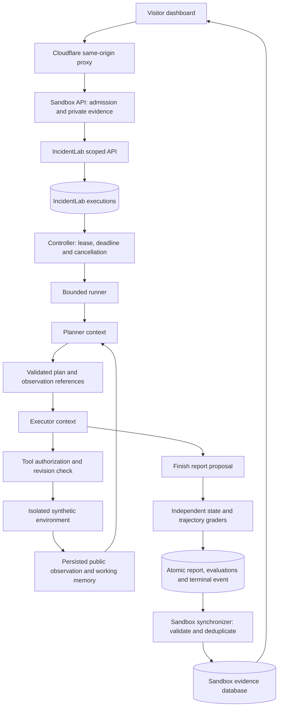

# IncidentLab — architecture and workflow

Status: System 3 implementation specification. Independent application runtime, not a dashboard-side agent. Environment is explicitly synthetic; all model-directed planning and execution must use a real provider in production. No canned agent responses ship in the runtime.

## Boundaries

Browser → Cloudflare Pages/Worker dashboard proxy → agents-lab-api admission/evidence service → private IncidentLab scoped HTTP API → controller → bounded runner subprocess. IncidentLab owns its PostgreSQL database, simulator state, provider credential, prompts, model calls and independent evaluation. EnergyOps and ContractLens remain unchanged. Dashboard credentials reach only the sandbox API.

## Model structures

Planner–executor is a fixed two-agent workflow: two separate model contexts and system prompts, not an autonomous supervisor. Planner formulates hypotheses and a typed plan; executor chooses a permitted diagnostic/action tool from that plan. Runtime validators, simulator and graders are deterministic components, not additional agents. A single-agent baseline uses the same tools, scenarios, environment seed and global budgets. These are selectable scenario presets, not an unsupported claim that teams improve performance.

## Workflow

1. Admit a fixed symptom scenario and topology with stable execution UUID. Persist queued status and immutable version/configuration manifest.
2. Controller locks execution ownership and starts a child with a 180-second hard deadline. Restart marks interrupted work failed; no paid-call replay.
3. Initialize an isolated seeded environment and persist an initial metrics observation. Ground truth stays private.
4. Planner receives the task, scoped latest observations, and per-run working ledger. It emits hypotheses, observation references, and at most three permitted next operations.
5. Executor receives the public task, that typed plan, and bounded observations. It selects one operation. Deterministic validation checks the plan, tool arguments, observation references and current environment revision.
6. Read metrics/logs, probe a dependency, or apply one allowlisted simulator action. Persist tool call, public observation, private environment snapshot and causal action record atomically. Nothing executes on the host or real services.
7. Actual environmental feedback updates the evidence ledger. Planner revises its hypotheses and plan. A stale or invalid action produces a rejection observation without changing the simulator; the agent must adapt.
8. Agent can propose finish with diagnosis, uncertainty and observation citations. At least two post-action healthy metrics observations are needed for an independently verified recovery; the agent cannot set recovery=true itself. It may finish unresolved or abstain.
9. Independent deterministic evaluator checks hidden cause, recovery, side effects, citation existence, trajectory and operations. Semantic explanation quality stays unknown. Final artifact, evaluations and success lifecycle transition commit together. Workflow success means a completed report, not necessarily incident recovery.
10. Sandbox synchronizes ordered events, validated report and evaluator outcomes. Transport loss stays distinct from workflow timeout/cancellation.

## Simulator presets

Latency: exhausted checkout DB pool; errors: defective checkout release; outage: failed inventory dependency. Seeds and hidden cause are fixed by versioned private scenario definitions. Latency includes a deterministic workload change after an early investigation step, so an observation must be refreshed. Tools expose symptoms, diagnostic findings and effects rather than private truth. Ineffective actions consume steps; some can worsen another metric. Reset isolation is per execution.

## Budgets and memory

180s wall clock, 20 model calls, 16 environment operations, 10 plan revisions, 80,000 UTF8 context bytes per call, 2400 output tokens per call, 200 evidence events, 24 KB per event and 512 KB integration response. One selected tool per model call; provider requests are not automatically retried. Per-run context is rebuilt from public state, recent observations and compact structured ledger, not an unbounded transcript. Record prompt/context hashes, source observation IDs, actual usage/model and latency. No hidden chain-of-thought is persisted or exposed.

Memory is durable per-run working state and evidence history. Environment feedback changes current hypotheses/plans. No cross-run learning, memory promotion, fine-tuning, checkpoints, human approval or arbitrary delegation is implemented. System 4 can add evaluated cross-episode memory later.

## Evaluation and comparison

Compare solo/team on matching scenario_revision, environment seed, provider model, tool version and global budgets. Store topology and seed in manifests. Report recovery and diagnosis separately, plus model calls/tokens, actions, invalid calls, simulated steps and latency. No aggregate benefit or monetary cost is claimed without actual paired trials/provider pricing telemetry. Runtime agents never see private evaluator labels. Evaluations are generated by code from persisted environment truth, not agent confidence.

## Workflow diagram

The solo preset combines the planner and executor decision in one model context; the same authorization, simulator, persistence and grading boundaries remain.

Provider tool-schema behavior was checked against the [official tool definition documentation](https://platform.claude.com/docs/en/agents-and-tools/tool-use/define-tools). IncidentLab uses auto tool choice with single-call validation, allowing models that reject forced tool choice; a missing or invalid tool call fails closed without automatic paid retries.
